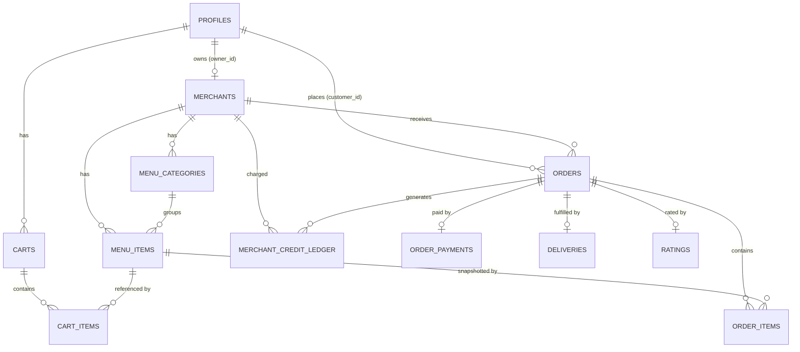

# SmartMappia — Food Delivery: Database (Supabase ERD + Migrations)

Data model for the Food Delivery service on the **existing** SmartMappia Supabase project. It reuses
`profiles` (users), Supabase Auth, RLS, and the payment/token approach from Pick & Drop. New tables
are namespaced conceptually to food delivery. All money is `numeric(10,2)` SAR; all ids are `uuid`.

The existing platform migrations run to `0008`. Food delivery adds `0009`–`0012` (below).

---

## 1. Roles

Reuse `profiles.role` (`user_role` enum). Add a **`merchant`** value:
- **customer** = a normal signed-up user (existing `passenger`/customer role) who orders food.
- **merchant** = a restaurant owner; their restaurant lives in `merchants` (1:1 to their profile).
- **admin** = existing admins (oversight, suspension, reconciliation).

```sql
alter type user_role add value if not exists 'merchant';
```

---

## 2. Entity-relationship diagram



---

## 3. Tables

### 3.1 `merchants` (restaurant)
| Column | Type | Notes |
|---|---|---|
| id | uuid PK | |
| owner_id | uuid FK → profiles(id) | the merchant user; unique (one restaurant per owner for MVP) |
| name | text NOT NULL | |
| cuisine_type | text | for search/filter |
| description | text | |
| logo_url | text | |
| address | text | |
| lat, lng | double precision | for 15 km radius delivery-fee check |
| service_radius_km | numeric | default 15 |
| is_active | boolean | default true (visible in discovery) |
| status | merchant_status | `active` / `suspended` |
| credit_limit | numeric(10,2) | default 300 |
| credit_used | numeric(10,2) | default 0 (running platform-margin owed) |
| created_at, updated_at | timestamptz | |

### 3.2 `menu_categories`
`id, merchant_id FK, name, sort_order int, is_active boolean, created_at`.

### 3.3 `menu_items`
| Column | Type | Notes |
|---|---|---|
| id | uuid PK | |
| merchant_id | uuid FK | |
| category_id | uuid FK → menu_categories | nullable |
| name, description | text | |
| price | numeric(10,2) NOT NULL | |
| item_type | item_type enum | `meal_package` (5 SAR margin) or `drink_dessert_addon` (3 SAR) |
| image_url | text | |
| is_available | boolean | default true |
| created_at, updated_at | timestamptz | |

### 3.4 `carts` + `cart_items` (persistent cart)
- `carts`: `id, customer_id FK, merchant_id FK, created_at, updated_at`; unique `(customer_id, merchant_id)` (one active cart per merchant).
- `cart_items`: `id, cart_id FK, menu_item_id FK, quantity int, unit_price numeric (snapshot), created_at`.

### 3.5 `orders`
| Column | Type | Notes |
|---|---|---|
| id | uuid PK | |
| order_code | text UNIQUE | human-friendly (e.g. `FD-XXXXXXXX`) |
| customer_id | uuid FK → profiles | |
| merchant_id | uuid FK → merchants | |
| status | order_status | pending/preparing/ready/out_for_delivery/delivered/cancelled/rejected |
| subtotal | numeric(10,2) | sum of item lines (must be ≥ 30 SAR — enforced server-side) |
| delivery_fee | numeric(10,2) | 10 SAR within radius |
| platform_margin_total | numeric(10,2) | sum of per-item margins |
| total | numeric(10,2) | subtotal + delivery_fee |
| distance_km | numeric | computed at checkout |
| delivery_address | text | |
| delivery_lat, delivery_lng | double precision | |
| payment_status | payment_status | awaiting/paid/failed/refunded |
| payment_method | payment_method | `stcpay` / `tap` |
| gateway_transaction_id | text | token/txn id only — never raw card data |
| created_at, accepted_at, ready_at, delivered_at | timestamptz | timeline |

### 3.6 `order_items`
`id, order_id FK, menu_item_id FK, name_snapshot text, unit_price numeric, quantity int, line_total numeric, margin_per_item numeric, margin_total numeric`.
(Snapshots so historical orders are immutable if the menu changes.)

### 3.7 `merchant_credit_ledger`
`id, merchant_id FK, order_id FK (nullable), type credit_ledger_type (charge/replenish/adjustment), amount numeric, balance_after numeric, created_at`.
Every accepted order writes a `charge` of its `platform_margin_total`; replenishments write `replenish`.

### 3.8 `order_payments`
`id, order_id FK, provider (stcpay/tap), amount numeric, status payment_status, gateway_transaction_id text, gateway_raw jsonb, created_at`. No raw card/CVV/expiry ever.

### 3.9 `deliveries` (optional MVP)
`id, order_id FK, driver_id uuid FK (nullable — reuse Pick & Drop drivers later), fee numeric, status, delivered_at`.

### 3.10 `ratings` (could-have)
`id, order_id FK unique, customer_id FK, merchant_id FK, food_rating int (1-5), speed_rating int, comment text, created_at`.

### 3.11 `promocodes` (could-have)
`id, code text unique, discount_type (percent/fixed), value numeric, min_order numeric, active boolean, starts_at, expires_at`.

### 3.12 `fd_analytics_events`
`id, event_name text, user_id uuid (nullable), order_id uuid (nullable), merchant_id uuid (nullable), params jsonb, created_at`. Server-side log of the events in the PRD analytics plan.

(Notifications reuse the existing `device_push_tokens` + `notification_events`.)

---

## 4. Enums (new)
| Enum | Values |
|---|---|
| `merchant_status` | `active`, `suspended` |
| `item_type` | `meal_package`, `drink_dessert_addon` |
| `order_status` | `pending`, `accepted`, `preparing`, `ready`, `out_for_delivery`, `delivered`, `cancelled`, `rejected` |
| `fd_payment_status` | `awaiting`, `paid`, `failed`, `refunded` (or reuse existing `payment_status`) |
| `fd_payment_method` | `stcpay`, `tap` |
| `credit_ledger_type` | `charge`, `replenish`, `adjustment` |
| `discount_type` | `percent`, `fixed` |

---

## 5. RLS model (every table)
- **Public read (discovery):** `merchants` where `is_active` + `status='active'`, and their
  `menu_categories` / `menu_items` where available. (Read-only, safe fields.)
- **Customer:** read/write own `carts`/`cart_items`; read own `orders`/`order_items`/`order_payments`/`ratings`.
- **Merchant:** full CRUD on their own `merchants` row, `menu_categories`, `menu_items`; read/update
  their own `orders`; read their own `merchant_credit_ledger`.
- **Admin:** read all; suspend merchants; reconcile credit (`is_admin()`).
- Backend uses the **service_role** key for trusted writes (order totals, credit charges, payment
  confirmation) — never trust client-sent totals.

Helper functions: `gen_order_code()` (like `gen_booking_code`, prefix `FD-`), and a
`fd_touch_updated_at` trigger reusing `set_updated_at()`.

---

## 6. Migrations plan (SQL files to create, in order)
- **`0009_food_delivery_core.sql`** — `merchant` role value; enums; `merchants`, `menu_categories`,
  `menu_items`; `gen_order_code()`; indexes; RLS + policies.
- **`0010_food_delivery_orders.sql`** — `carts`, `cart_items`, `orders`, `order_items`,
  `order_payments`, `deliveries`; enums for order/payment; indexes; RLS.
- **`0011_food_delivery_credit.sql`** — `merchant_credit_ledger`; the 300 SAR limit + 80% alert
  columns/logic; RLS. (Credit charge/suspension logic is enforced in the backend, not triggers, for
  MVP simplicity — see the backend doc.)
- **`0012_food_delivery_extras.sql`** — `ratings`, `promocodes`, `fd_analytics_events`; RLS.

Apply in the Supabase SQL Editor in order. Do not apply to production until reviewed. Create no new
storage buckets unless menu images are uploaded to Supabase Storage — if so, add a **public**
`menu-images` bucket (menu photos are non-sensitive) or a signed-URL flow like driver docs if you
prefer private.

---

## 7. Money math (single source of truth — server-side)
For each order at checkout the backend computes and stores:
- `subtotal = Σ(unit_price × quantity)` — **reject if < 30 SAR**.
- `margin_per_item` = 5 (meal_package) or 3 (drink_dessert_addon); `margin_total = Σ margins`.
- `delivery_fee` = 10 if `distance_km ≤ 15` (promo window) else a to-be-defined tiered fee.
- `total = subtotal + delivery_fee` (customer pays). Platform revenue = `margin_total`.
On merchant **accept**: write a `merchant_credit_ledger` charge of `margin_total`, increment
`merchants.credit_used`; if `credit_used ≥ 240` fire the 80% alert; if `≥ 300`, block further accepts
(set/observe `merchant_status='suspended'` semantics).
