# SmartMappia — Database ERD

Entity-relationship reference for the SmartMappia database (Supabase / PostgreSQL 15+), covering the live schema (migrations `0001`–`0003`; `0004` pilot was NOT applied to the current project) plus the planned tables and columns from migrations `0005`–`0008`.

**Last updated: 23 June 2026**

> **Legend for this document**
> - (new) = **planned / new** — defined in migrations `0005`–`0008`, not yet applied to production.
> - Everything not tagged (new) is **existing** — already shipped in migrations `0001`–`0004`.
> - All `*_id` columns are `uuid`. `PK` = primary key, `FK` = foreign key.
> - `cascade` / `set null` after an FK is the `ON DELETE` behaviour.

---

## 1. Entity-Relationship Diagram (Mermaid)

```mermaid
erDiagram
    AUTH_USERS ||--|| PROFILES : "1:1 (auth identity)"
    PROFILES ||--o{ BOOKINGS : "books (user_id)"
    PROFILES ||--o{ BOOKINGS : "drives (assigned_driver_id)"
    PROFILES ||--o{ PAYMENT_PROOFS : "uploads"
    PROFILES ||--o{ PAYMENT_PROOFS : "reviews (admin)"
    PROFILES ||--o{ PAYMENTS : "verifies (admin)"
    PROFILES ||--o{ TRACKING_EVENTS : "creates"
    PROFILES ||--o{ DRIVER_LOCATIONS : "pings"
    PROFILES ||--o{ LEDGER_ENTRIES : "earns (driver)"
    PROFILES ||--o{ DRIVER_DOCUMENTS : "submits"
    PROFILES ||--o{ DRIVER_DOCUMENTS : "reviews (admin)"
    PROFILES ||--o{ DEVICE_PUSH_TOKENS : "registers"
    PROFILES ||--o{ NOTIFICATION_EVENTS : "receives"

    BOOKINGS ||--o{ PAYMENT_PROOFS : "has"
    BOOKINGS ||--o{ PAYMENTS : "has"
    BOOKINGS ||--o{ TRACKING_EVENTS : "logs"
    BOOKINGS ||--o{ LEDGER_ENTRIES : "settles"
    BOOKINGS ||--o{ WEBHOOK_EVENTS : "referenced by"
    BOOKINGS ||--o{ NOTIFICATION_EVENTS : "triggers"

    PROFILES {
        uuid id PK "FK auth.users (cascade)"
        user_role role "default passenger"
        text full_name
        text mobile_number
        text whatsapp_number
        text email
        boolean driver_approved "default false (0004 pilot NOT applied here)"
        date date_of_birth
        text gender
        text national_id
        text vehicle_type
        text vehicle_plate
        driver_verification_status driver_verification_status "NEW default none"
        timestamptz created_at
        timestamptz updated_at
    }

    BOOKINGS {
        uuid id PK
        text booking_code UK "default gen_booking_code()"
        uuid user_id FK "profiles (set null)"
        trip_type trip_type "NOT NULL"
        order_type order_type "NEW default pick_drop"
        text airport_terminal
        text pickup_address
        double pickup_lat
        double pickup_lng
        text dropoff_address
        double dropoff_lat
        double dropoff_lng
        timestamptz pickup_datetime
        int passenger_count "default 1"
        int luggage_count "default 0"
        numeric fare_amount "NOT NULL"
        text currency "default SAR"
        payment_method payment_method
        payment_status payment_status
        booking_status booking_status
        verification_mode verification_mode
        uuid assigned_driver_id FK "profiles (set null)"
        driver_ride_status driver_ride_status
        timestamptz created_at
        timestamptz updated_at
    }

    PAYMENT_PROOFS {
        uuid id PK
        uuid booking_id FK "bookings (cascade)"
        uuid uploaded_by_user_id FK "profiles (set null)"
        text file_url "NOT NULL"
        text file_hash
        proof_status status "default uploaded"
        verification_mode verification_mode
        uuid admin_reviewer_id FK "profiles (set null)"
        timestamptz created_at
    }

    PAYMENTS {
        uuid id PK
        uuid booking_id FK "bookings (cascade)"
        payment_provider provider "default stcpay_manual"
        numeric amount "NOT NULL"
        text currency "default SAR"
        payment_status status
        uuid verified_by_admin_id FK "profiles (set null)"
        boolean verified_by_system
        text gateway_payment_id "NEW unique"
        jsonb gateway_raw "NEW"
        timestamptz created_at
    }

    TRACKING_EVENTS {
        uuid id PK
        uuid booking_id FK "bookings (cascade)"
        text event_type "NOT NULL"
        text title
        text message
        uuid created_by_user_id FK "profiles (set null)"
        timestamptz created_at
    }

    DRIVER_LOCATIONS {
        uuid id PK
        uuid driver_id FK "profiles (cascade)"
        double lat "NOT NULL"
        double lng "NOT NULL"
        double accuracy_meters
        timestamptz recorded_at
    }

    LEDGER_ENTRIES {
        uuid id PK
        uuid booking_id FK "bookings (cascade)"
        uuid driver_id FK "profiles (set null)"
        numeric gross_fare "NOT NULL"
        numeric platform_commission
        numeric driver_net
        numeric platform_net
        payout_status payout_status "default pending"
        timestamptz created_at
    }

    DRIVER_DOCUMENTS {
        uuid id PK "NEW"
        uuid driver_id FK "profiles (cascade)"
        driver_doc_type doc_type "NOT NULL"
        text storage_path "NOT NULL"
        text file_hash
        date expiry_date
        driver_doc_status status "default pending"
        uuid reviewed_by_admin_id FK "profiles (set null)"
        timestamptz created_at
    }

    WEBHOOK_EVENTS {
        uuid id PK "NEW"
        text provider
        text event_type
        text gateway_payment_id
        uuid booking_id FK "bookings (set null)"
        boolean signature_verified
        jsonb payload
        timestamptz created_at
    }

    DEVICE_PUSH_TOKENS {
        uuid id PK "NEW"
        uuid user_id FK "profiles (cascade)"
        text token "NOT NULL"
        text platform "android/ios/web"
        timestamptz last_seen_at
        timestamptz created_at
    }

    NOTIFICATION_EVENTS {
        uuid id PK "NEW"
        uuid user_id FK "profiles (set null)"
        uuid booking_id FK "bookings (set null)"
        text type
        text channel
        timestamptz sent_at
        timestamptz created_at
    }
```

> Note for Mermaid: `double` = `double precision`, `numeric` = `numeric(10,2)`. The diagram lists key columns only; full attribute lists are in Section 2.

---

## 2. Per-entity attribute tables

### 2.1 `profiles`
One row per person, hanging off Supabase `auth.users`. Distinguishes passengers, drivers and admins, and stores contact + driver-application details.

| Column | Type | Notes |
|---|---|---|
| `id` | `uuid` | **PK**, FK → `auth.users(id)` `ON DELETE cascade` |
| `role` | `user_role` | NOT NULL, default `'passenger'` |
| `full_name` | `text` | |
| `mobile_number` | `text` | |
| `whatsapp_number` | `text` | Surfaced to passengers via `get_tracking_by_code()` |
| `email` | `text` | |
| `driver_approved` | `boolean` | NOT NULL. Default `false` in `0002`; `0004` (pilot) would flip it to `true` but was NOT applied here, so the default stays `false` — drivers are auto-approved in code (`authController.js`) during the pilot instead |
| `date_of_birth` | `date` | Added in `0003` |
| `gender` | `text` | Added in `0003` |
| `national_id` | `text` | Added in `0003` |
| `vehicle_type` | `text` | Added in `0003` |
| `vehicle_plate` | `text` | Added in `0003` |
| `driver_verification_status` (new) | `driver_verification_status` | **NEW (0005)**, default `'none'` |
| `created_at` | `timestamptz` | NOT NULL, default `now()` |
| `updated_at` | `timestamptz` | NOT NULL, default `now()`; maintained by `profiles_set_updated_at` trigger |

*Triggers / indexes:* `profiles_set_updated_at` (BEFORE UPDATE → `set_updated_at()`); `idx_profiles_role` on `(role)`.

---

### 2.2 `bookings`
The core entity — one row is one trip: route, price, payment state, ride state, and assigned driver. Guest bookings are supported (`user_id` may be null), so passenger contact details live directly on the row.

| Column | Type | Notes |
|---|---|---|
| `id` | `uuid` | **PK**, default `gen_random_uuid()` |
| `booking_code` | `text` | UNIQUE, NOT NULL, default `gen_booking_code()` (e.g. `SM-7K3PQ9TM`) |
| `user_id` | `uuid` | FK → `profiles(id)` `ON DELETE set null` (null = guest booking) |
| `trip_type` | `trip_type` | NOT NULL |
| `order_type` (new) | `order_type` | **NEW (0007)**, default `'pick_drop'` |
| `airport_terminal` | `text` | |
| `pickup_address` | `text` | |
| `pickup_lat` | `double precision` | |
| `pickup_lng` | `double precision` | |
| `dropoff_address` | `text` | |
| `dropoff_lat` | `double precision` | |
| `dropoff_lng` | `double precision` | |
| `pickup_datetime` | `timestamptz` | |
| `passenger_count` | `int` | default `1` |
| `luggage_count` | `int` | default `0` |
| `notes` | `text` | |
| `passenger_name` | `text` | |
| `passenger_mobile` | `text` | |
| `passenger_whatsapp` | `text` | |
| `passenger_email` | `text` | |
| `fare_amount` | `numeric(10,2)` | NOT NULL; frozen at booking time |
| `currency` | `text` | NOT NULL, default `'SAR'` |
| `payment_method` | `payment_method` | NOT NULL, default `'stcpay_manual'` |
| `payment_status` | `payment_status` | NOT NULL, default `'awaiting_proof'` |
| `booking_status` | `booking_status` | NOT NULL, default `'pending_payment'` |
| `verification_mode` | `verification_mode` | |
| `test_auto_verified_at` | `timestamptz` | |
| `confirmed_at` | `timestamptz` | |
| `assigned_driver_id` | `uuid` | FK → `profiles(id)` `ON DELETE set null` |
| `driver_ride_status` | `driver_ride_status` | |
| `scheduled_pickup_eta_text` | `text` | MVP: filled by hand |
| `payment_confirmation_eta_text` | `text` | MVP: filled by hand |
| `driver_arrival_eta_minutes` | `int` | |
| `passenger_snapshot_name` (new) | `text` | **NEW (0007)** point-in-time snapshot |
| `passenger_snapshot_whatsapp` (new) | `text` | **NEW (0007)** |
| `passenger_snapshot_mobile` (new) | `text` | **NEW (0007)** |
| `driver_snapshot_name` (new) | `text` | **NEW (0007)** |
| `driver_snapshot_vehicle_type` (new) | `text` | **NEW (0007)** |
| `driver_snapshot_vehicle_plate` (new) | `text` | **NEW (0007)** |
| `driver_assigned_at` (new) | `timestamptz` | **NEW (0007)** |
| `actual_pickup_at` (new) | `timestamptz` | **NEW (0007)** |
| `actual_dropoff_at` (new) | `timestamptz` | **NEW (0007)** |
| `created_at` | `timestamptz` | NOT NULL, default `now()` |
| `updated_at` | `timestamptz` | NOT NULL, default `now()`; maintained by `bookings_set_updated_at` trigger |

*Triggers / indexes:* `bookings_set_updated_at`; indexes on `user_id`, `assigned_driver_id`, `booking_status`, `payment_status`, `created_at desc`.

> (new) **(0007)** `gen_booking_code()` gains an `order_type` argument and prefixes by order type: `SM-PD-` (pick_drop), `SM-FD-` (food), `SM-SH-` (shop), `SM-PK-` (package) + 8-char suffix.

---

### 2.3 `payment_proofs`
One row per uploaded STC Pay screenshot. Stores the storage path (bytes live in a private bucket) plus a hash so a re-used receipt can be spotted.

| Column | Type | Notes |
|---|---|---|
| `id` | `uuid` | **PK**, default `gen_random_uuid()` |
| `booking_id` | `uuid` | NOT NULL, FK → `bookings(id)` `ON DELETE cascade` |
| `uploaded_by_user_id` | `uuid` | FK → `profiles(id)` `ON DELETE set null` |
| `file_url` | `text` | NOT NULL; path in the private bucket |
| `file_name` | `text` | |
| `file_mime_type` | `text` | |
| `file_size_bytes` | `bigint` | |
| `file_hash` | `text` | sha256, for duplicate detection |
| `status` | `proof_status` | NOT NULL, default `'uploaded'` |
| `verification_mode` | `verification_mode` | |
| `admin_reviewer_id` | `uuid` | FK → `profiles(id)` `ON DELETE set null` |
| `reviewed_at` | `timestamptz` | |
| `test_auto_verified_at` | `timestamptz` | |
| `rejection_reason` | `text` | |
| `created_at` | `timestamptz` | NOT NULL, default `now()` |

*Indexes:* `idx_proofs_booking` on `(booking_id)`; `idx_proofs_hash` on `(file_hash)`.

---

### 2.4 `payments`
The record of money that actually came in. Extended in `0007` (0006 in this doc's grouping) for the Tap Payments gateway.

| Column | Type | Notes |
|---|---|---|
| `id` | `uuid` | **PK**, default `gen_random_uuid()` |
| `booking_id` | `uuid` | NOT NULL, FK → `bookings(id)` `ON DELETE cascade` |
| `provider` | `payment_provider` | NOT NULL, default `'stcpay_manual'` |
| `amount` | `numeric(10,2)` | NOT NULL |
| `currency` | `text` | NOT NULL, default `'SAR'` |
| `status` | `payment_status` | NOT NULL, default `'awaiting_proof'` |
| `manual_reference` | `text` | |
| `verified_by_admin_id` | `uuid` | FK → `profiles(id)` `ON DELETE set null` |
| `verified_by_system` | `boolean` | NOT NULL, default `false` |
| `verification_mode` | `verification_mode` | |
| `verified_at` | `timestamptz` | |
| `notes` | `text` | |
| `gateway_provider` (new) | `text` | **NEW (0006)** |
| `gateway_payment_id` (new) | `text` | **NEW (0006)**, UNIQUE |
| `gateway_reference` (new) | `text` | **NEW (0006)** |
| `gateway_status` (new) | `text` | **NEW (0006)** |
| `gateway_raw` (new) | `jsonb` | **NEW (0006)** raw gateway payload |
| `created_at` | `timestamptz` | NOT NULL, default `now()` |

*Indexes:* `idx_payments_booking` on `(booking_id)`.

---

### 2.5 `tracking_events`
The trip's story, one line at a time — feeds the live timeline the passenger watches.

| Column | Type | Notes |
|---|---|---|
| `id` | `uuid` | **PK**, default `gen_random_uuid()` |
| `booking_id` | `uuid` | NOT NULL, FK → `bookings(id)` `ON DELETE cascade` |
| `event_type` | `text` | NOT NULL (e.g. `booking_created`, `proof_uploaded`, `auto_verified`) |
| `title` | `text` | |
| `message` | `text` | |
| `created_by_user_id` | `uuid` | FK → `profiles(id)` `ON DELETE set null` |
| `created_at` | `timestamptz` | NOT NULL, default `now()` |

*Indexes:* `idx_events_booking` on `(booking_id, created_at)`.

---

### 2.6 `driver_locations`
The breadcrumb trail of where a driver is — powers the moving car on the map and the live ETA.

| Column | Type | Notes |
|---|---|---|
| `id` | `uuid` | **PK**, default `gen_random_uuid()` |
| `driver_id` | `uuid` | NOT NULL, FK → `profiles(id)` `ON DELETE cascade` |
| `lat` | `double precision` | NOT NULL |
| `lng` | `double precision` | NOT NULL |
| `accuracy_meters` | `double precision` | |
| `recorded_at` | `timestamptz` | NOT NULL, default `now()` |

*Indexes:* `idx_driver_locations` on `(driver_id, recorded_at desc)`.

---

### 2.7 `ledger_entries`
Who gets paid what — written when a trip finishes. Holds the platform's cut and the driver's take-home.

| Column | Type | Notes |
|---|---|---|
| `id` | `uuid` | **PK**, default `gen_random_uuid()` |
| `booking_id` | `uuid` | NOT NULL, FK → `bookings(id)` `ON DELETE cascade` |
| `driver_id` | `uuid` | FK → `profiles(id)` `ON DELETE set null` |
| `gross_fare` | `numeric(10,2)` | NOT NULL |
| `platform_commission` | `numeric(10,2)` | NOT NULL, default `0` |
| `manual_payment_fee` | `numeric(10,2)` | NOT NULL, default `0` |
| `driver_gross` | `numeric(10,2)` | NOT NULL, default `0` |
| `driver_net` | `numeric(10,2)` | NOT NULL, default `0` |
| `platform_net` | `numeric(10,2)` | NOT NULL, default `0` |
| `payout_status` | `payout_status` | NOT NULL, default `'pending'` |
| `created_at` | `timestamptz` | NOT NULL, default `now()` |

*Indexes:* `idx_ledger_booking` on `(booking_id)`; `idx_ledger_driver` on `(driver_id)`.

---

### 2.8 `driver_documents` (new) (Migration 0005)
One row per uploaded driver verification document. Bytes live in private Storage; the row keeps the path, hash, expiry and review state.

| Column | Type | Notes |
|---|---|---|
| `id` | `uuid` | **PK** |
| `driver_id` | `uuid` | NOT NULL, FK → `profiles(id)` `ON DELETE cascade` |
| `doc_type` | `driver_doc_type` | NOT NULL |
| `storage_path` | `text` | NOT NULL |
| `file_name` | `text` | |
| `mime_type` | `text` | |
| `file_size_bytes` | `bigint` | |
| `file_hash` | `text` | |
| `expiry_date` | `date` | |
| `status` | `driver_doc_status` | default `'pending'` |
| `rejection_reason` | `text` | |
| `reviewed_by_admin_id` | `uuid` | FK → `profiles(id)` `ON DELETE set null` |
| `reviewed_at` | `timestamptz` | |
| `created_at` | `timestamptz` | |
| `updated_at` | `timestamptz` | |

---

### 2.9 `webhook_events` (new) (Migration 0006, optional)
Audit log of inbound payment-gateway webhooks (Tap Payments). Lets the system de-duplicate and verify signatures before acting.

| Column | Type | Notes |
|---|---|---|
| `id` | `uuid` | **PK** |
| `provider` | `text` | |
| `event_type` | `text` | |
| `gateway_payment_id` | `text` | |
| `booking_id` | `uuid` | FK → `bookings(id)` `ON DELETE set null` |
| `signature_verified` | `boolean` | |
| `payload` | `jsonb` | Raw webhook body |
| `processed_at` | `timestamptz` | |
| `created_at` | `timestamptz` | |

---

### 2.10 `device_push_tokens` (new) (Migration 0008)
Registered push-notification tokens per user/device.

| Column | Type | Notes |
|---|---|---|
| `id` | `uuid` | **PK** |
| `user_id` | `uuid` | NOT NULL, FK → `profiles(id)` `ON DELETE cascade` |
| `token` | `text` | NOT NULL |
| `platform` | `text` / enum | `android`, `ios`, `web` |
| `app_version` | `text` | |
| `last_seen_at` | `timestamptz` | |
| `created_at` | `timestamptz` | |
| `updated_at` | `timestamptz` | |

*Constraints:* `UNIQUE (user_id, token)`.

---

### 2.11 `notification_events` (new) (Migration 0008, optional)
Audit log of notifications sent to users.

| Column | Type | Notes |
|---|---|---|
| `id` | `uuid` | **PK** |
| `user_id` | `uuid` | FK → `profiles(id)` `ON DELETE set null` |
| `booking_id` | `uuid` | FK → `bookings(id)` `ON DELETE set null` |
| `type` | `text` | |
| `channel` | `text` | e.g. `push`, `whatsapp`, `email` |
| `sent_at` | `timestamptz` | |
| `created_at` | `timestamptz` | |

---

## 3. Enums

### Existing (migrations 0001–0004)

| Enum | Values |
|---|---|
| `user_role` | `passenger`, `driver`, `admin` |
| `trip_type` | `house_to_airport`, `airport_to_house` |
| `payment_method` | `stcpay_manual`, `moyasar` |
| `payment_provider` | `stcpay_manual`, `moyasar` |
| `payment_status` | `awaiting_proof`, `proof_uploaded`, `under_review`, `verified`, `rejected`, `refunded` |
| `verification_mode` | `test_auto`, `admin_manual`, `moyasar_webhook` |
| `booking_status` | `pending_payment`, `payment_under_review`, `confirmed`, `driver_assigned`, `driver_on_the_way`, `arrived`, `in_progress`, `completed`, `cancelled` |
| `driver_ride_status` | `assigned`, `accepted`, `on_the_way`, `arrived`, `started`, `completed`, `cancelled` |
| `proof_status` | `uploaded`, `under_review`, `verified`, `rejected` |
| `payout_status` | `pending`, `simulated_test`, `paid`, `cancelled` |

### Planned / new

| Enum | Values | Source |
|---|---|---|
| `driver_doc_type` (new) | `national_id`, `license`, `vehicle_registration`, `insurance`, `tga_permit`, `profile_photo`, `vehicle_photo` | 0005 |
| `driver_doc_status` (new) | `pending`, `verified`, `rejected` | 0005 |
| `driver_verification_status` (new) | `none`, `submitted`, `approved`, `rejected` | 0005 |
| `order_type` (new) | `pick_drop`, `food`, `shop`, `package` | 0007 |

### Enum value additions to existing enums (new)

| Enum | Added value | Source |
|---|---|---|
| `verification_mode` | `gateway_webhook` (new) | 0006 |
| `payment_provider` | `tap` (new) | 0006 |
| `payment_method` | `tap` (new) | 0006 |

---

## 4. Relationships / legend

**Cardinality** — all are one-to-many (`||--o{`) unless noted:

- `auth.users (1) — (1) profiles` — every app person is one Supabase auth identity; `profiles.id` IS the `auth.users.id` (shared PK, cascade delete).
- `profiles (1) — (many) bookings` — twice over: as the **passenger** (`bookings.user_id`) and as the **assigned driver** (`bookings.assigned_driver_id`). Both FKs `set null` on delete, so booking history survives an account removal.
- `bookings (1) — (many) payment_proofs / payments / tracking_events / ledger_entries` — children cascade-delete with the booking.
- `bookings (1) — (many) webhook_events` (new) and `notification_events` (new) — both `set null` (audit rows outlive the booking).
- `profiles (1) — (many) payment_proofs` — as **uploader** (`uploaded_by_user_id`) and as **admin reviewer** (`admin_reviewer_id`).
- `profiles (1) — (many) payments` — as **admin verifier** (`verified_by_admin_id`).
- `profiles (1) — (many) tracking_events` — as **author** (`created_by_user_id`).
- `profiles (1) — (many) driver_locations` — driver location pings (cascade delete).
- `profiles (1) — (many) ledger_entries` — as **driver** (`driver_id`, set null).
- `profiles (1) — (many) driver_documents` (new) — as **submitter** (cascade) and **admin reviewer** (set null).
- `profiles (1) — (many) device_push_tokens` (new) (cascade) and `notification_events` (new) (set null).

**Delete behaviour summary**
- `cascade`: `profiles→auth.users`, and the booking/driver children that have no meaning without their parent (`payment_proofs`, `payments`, `tracking_events`, `ledger_entries.booking_id`, `driver_locations`, `driver_documents.driver_id`, `device_push_tokens`).
- `set null`: links that should preserve historical/audit rows when the referenced person or booking is removed (`bookings.user_id`, `bookings.assigned_driver_id`, all reviewer/verifier/creator FKs, `ledger_entries.driver_id`, `webhook_events.booking_id`, `notification_events.*`).

**Security model (RLS)** — every table has Row-Level Security enabled. The backend uses the Supabase **service role** key, which bypasses RLS for trusted server-side work (verifying payments, assigning drivers, writing payouts). Browser/anon clients can only read what is genuinely theirs:
- `profiles`: self-select/self-update; admins see all (`is_admin()`).
- `bookings`: owner, assigned driver, or admin.
- `payments`, `payment_proofs`, `ledger_entries`: admin-only direct reads.
- `tracking_events`: visible to people on that booking.
- `driver_locations`: a driver sees only their own pings.
- Public trip tracking goes through `get_tracking_by_code(text)` (SECURITY DEFINER, granted to `anon`/`authenticated`) — it returns only safe fields by booking code, never internal UUIDs.

**Helper functions / triggers**
- `set_updated_at()` — trigger fn keeping `updated_at` current (`profiles`, `bookings`).
- `gen_booking_code()` — generates human-friendly codes (`SM-XXXXXXXX`); (new) gains an `order_type` parameter in 0007 for `SM-PD-/FD-/SH-/PK-` prefixes.
- `is_admin()` — SECURITY DEFINER boolean used inside RLS policies.

**Optional reporting view** (new) (0007): `booking_report_v` — denormalised reporting view joining `bookings` ⋈ `profiles` ⋈ `payments` ⋈ `ledger_entries`.

---

## 5. Migration provenance

| Migration | Status | Adds |
|---|---|---|
| `0001_init_smart_mappia.sql` | Applied | Core schema: all base tables, enums, triggers, RLS, `get_tracking_by_code()` |
| `0002_auth_driver_approval.sql` | Applied | `profiles.driver_approved`, `idx_profiles_role` |
| `0003_profile_registration_fields.sql` | Applied | `profiles`: `date_of_birth`, `gender`, `national_id`, `vehicle_type`, `vehicle_plate` |
| `0004_auto_approve_drivers.PILOT.sql` | NOT applied (skipped) | Would flip `driver_approved` default to `true` — pilot-only; not run in this project (auto-approve is code-side in `authController.js` instead) |
| `0005` (driver verification) | (new) Planned | `driver_documents` table, 3 new enums, `profiles.driver_verification_status` |
| `0006` (Tap Payments gateway) | (new) Planned | `payments` gateway columns, `webhook_events` table, enum additions (`gateway_webhook`, `tap`) |
| `0007` (data collection) | (new) Planned | `order_type` enum, `bookings` snapshot + timestamp columns, `gen_booking_code()` order-type param, `booking_report_v` view |
| `0008` (notifications/push) | (new) Planned | `device_push_tokens`, `notification_events` tables |
